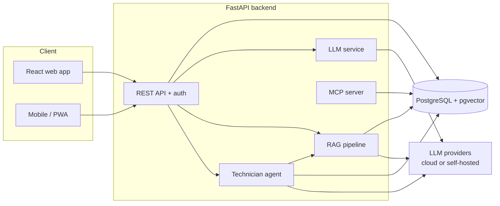

# Maintenance AI

**An AI-powered maintenance assistant for factory machines.**

Technicians describe a problem in plain language, snap a photo, or record a voice note. Maintenance AI turns it into a structured work order, finds the relevant page in the machine manual, suggests a diagnosis based on the machine's history, and lets a human approve every action before anything changes.

> 🚧 **Status: early development.** This project is being built in public, milestone by milestone. See the [roadmap](#roadmap) for what works today and what is planned.

---

## Why

On a factory floor, maintenance knowledge is scattered: handwritten notes, thick PDF manuals, and the memory of senior technicians. When a machine stops, every minute of downtime is expensive, and the answer is often buried somewhere nobody has time to search.

Maintenance AI explores how modern AI can help, without taking the human out of the loop:

- **AI proposes, humans decide.** Every AI-generated work order or agent action is a draft until a technician or supervisor approves it.
- **Answers cite their sources.** The troubleshooting assistant links each answer to the exact manual page it came from.
- **Data can stay on-site.** The system can switch between cloud LLMs and a self-hosted model, for factories that cannot send data outside their network.

## Planned features

| Area | Feature |
|---|---|
| **Core** | Machine registry, work orders (corrective & preventive), technician and supervisor roles |
| **Damage reports** | Free-text technician notes → structured work order draft, reviewed before saving |
| **Shift reports** | AI-written shift summaries, streamed as they are generated |
| **Ask the Manual** | Troubleshooting chat over uploaded machine manuals and SOPs (RAG), with clickable citations |
| **Technician Agent** | Agent that reads machine history, searches manuals, and proposes a diagnosis and work order, with live steps and human approval |
| **MCP server** | Exposes maintenance data to Claude and other MCP clients |
| **Production readiness** | Prompt-injection hardening, LLM tracing, cost & latency dashboard, automated evals in CI |
| **Mobile & multimodal** | Photo of a damaged part and voice reports from the factory floor |

## Architecture



## Tech stack

| Layer | Technology |
|---|---|
| Backend | Python, FastAPI, Pydantic, SQLModel |
| Database | PostgreSQL, pgvector, Alembic |
| Frontend | React, TypeScript, Vite, Tailwind CSS, TanStack Query |
| AI | LLM APIs (Claude, Gemini, OpenAI-compatible), Ollama for self-hosted models, embeddings, RAG, agents, MCP |
| Quality | pytest, LLM evaluations, tracing & observability |
| Infrastructure | Docker, docker compose, GitHub Actions |

The stack will be refined as the project grows. Choices and trade-offs will be documented in [`docs/`](docs/).

## Project structure

```
maintenance-ai/
├── backend/          # FastAPI app, AI services, tests
│   ├── app/
│   └── tests/
├── frontend/         # React + TypeScript web app
├── docs/             # Architecture notes and design decisions
└── docker-compose.yml
```

## Roadmap

The project is built in six stages. Each stage adds working features to the same application. AI topics follow the [roadmap.sh AI Engineer roadmap](https://roadmap.sh/ai-engineer).

### Stage 0 · Full-stack foundation
- [ ] Data models for machines and work orders
- [ ] REST endpoints for machines and work orders
- [ ] Automated test suite
- [ ] PostgreSQL persistence and migrations
- [ ] Authentication and roles (technician, supervisor)
- [ ] Web dashboard for machines and work orders
- [ ] Docker compose and CI

### Stage 1 · Damage report assistant
- [ ] First LLM integration and sampling experiments
- [ ] Technician notes → structured work order draft
- [ ] "Report damage" page with human review
- [ ] Streaming shift reports
- [ ] Switchable models: cloud vs self-hosted

### Stage 2 · Ask the Manual
- [ ] Semantic search over machine manuals
- [ ] Manual upload and indexing in pgvector
- [ ] RAG with citations, built from scratch
- [ ] Rebuild with a RAG framework and compare
- [ ] Multi-turn troubleshooting and context management
- [ ] Troubleshooting chat page

### Stage 3 · Technician agent
- [ ] Hand-written agent loop with tool calling
- [ ] Agent SDK and multi-agent setup
- [ ] Agent page with live steps and human approval
- [ ] MCP server for maintenance data

### Stage 4 · Production readiness
- [ ] Adversarial testing and prompt-injection defenses
- [ ] Tracing, cost and latency dashboard
- [ ] Automated evaluations and regression tests in CI

### Stage 5 · Multimodal & release
- [ ] Photo and voice reports on mobile
- [ ] Public deployment with demo account
- [ ] Documentation and demo video

## Getting started

Setup instructions will be added once the first runnable version is ready (Stage 0).

## Author

**Zahid Faqih Alim Rabbani** · [@zafar2154](https://github.com/zafar2154)